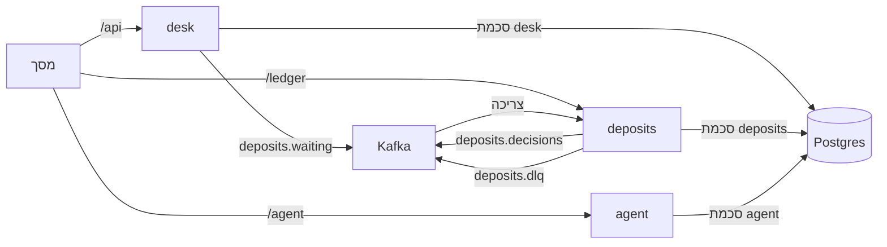

# בנק אופק — דלפק הפקדות

מערכת מקומית לקליטת קובץ הפקדות, לעיבודן בלחיצת כפתור, ולמענה על שאלות בנקאי. עולה בפקודה אחת עם PostgreSQL ו-Kafka. אין שירותי ענן.

המסך: [http://localhost:8088](http://localhost:8088). בנקאי לדוגמה: `teller` / `teller`.

## הרצה

דרושים Docker ו-Docker Compose. מפתח המודל נטען מהסביבה ואינו נשמר ב-Git.

```bash
git clone <כתובת הריפו>
cd ofek-deposits
copy .env.example .env
```

לפני `docker compose` יש להגדיר `OPENAI_API_KEY` ב-`.env` או בסביבת המעטפת. בלי מפתח הדלפק והעיבוד עולים, והסוכן מחזיר 503.

```bash
docker compose up --build
```

`init.sql` רץ רק על volume חדש. אחרי שינוי סכמה:

```bash
docker compose down -v
docker compose up --build
```

| שירות | כתובת | תפקיד |
| --- | --- | --- |
| web | http://localhost:8088 | המסך. מתווך `/api`, `/agent`, `/ledger` |
| desk | http://localhost:3000 | קליטה, בנקאים, פרסום ל-Kafka |
| deposits | http://localhost:3002 | עיבוד, יתרות, אישור |
| agent | http://localhost:3001 | שאלות. קריאה בלבד |
| Postgres | localhost:5432 | מסד `ofek` |
| Kafka | localhost:9092 | `deposits.waiting`, `deposits.decisions`, `deposits.dlq` |

לכל שירות יישום יש `GET /health`. למסך יש `/health`. ל-Postgres יש healthcheck ב-Compose.

## מהלך הדגמה

1. כניסה כ-`teller`.
2. העלאת `deposits_candidate_data.xlsx`. המסך מציג כמה שורות נקראו, כמה יישמרו, וכמה נדחות ולמה.
3. הורדת קובץ הדחיות, ואז «שמור קליטה». הביטול לא כותב כלום.
4. «עבד הפקדות ממתינות». חלון האישור מציג כמה ממתינות ומה הסכום לפי מטבע.
5. אחרי הלחיצה המסך מרענן כל שעתיים שניות עד שכל הפקדה מגיעה ל-`Completed`, `Failed` או `PendingApproval`, ומציג היסטוריה וסיבת כשל.
6. הפקדה מעל מיליון ש"ח ממתינה לאישור או לדחייה של בנקאי.
7. שורות `Failed` מהקובץ לא יוצאות בכפתור הראשי. מסמנים אותן ולוחצים «נסה שוב».
8. שאלות לסוכן באותו מסך.

## ארכיטקטורה

תרשים מלא: [`docs/architecture.md`](docs/architecture.md).



שירותים מדברים ביניהם רק ב-HTTP או ב-Kafka. אף שירות לא קורא טבלאות של שירות אחר.

- **desk** מחזיק בנקאים, סשנים, יומן טעינות, לקוחות, שורות קליטה ואצוות עיבוד. רק הוא מפרסם ל-`deposits.waiting`.
- **deposits** מחזיק שערים, מדיניות ניסיון חוזר, תיקים, היסטוריית סטטוס, תנועות ויתרות. הוא לא קורא את `desk.customers`. סטטוס הלקוח ומספר החשבון מגיעים בגוף ההודעה.
- **agent** בלי טבלאות משלו. `agent_reader` רשאי רק `SELECT` על views בסכמת `agent`. ה-views בלי מספר זהות ובלי טלפון, ומוסיפים `retryable` מתוך `deposits.retry_policy`.

מסד אחד, שלוש סכמות, שלושה משתמשי התחברות: `desk_user`, `deposits_user`, `agent_reader`. למשתמש הסוכן יש `default_transaction_read_only` ומגבלת משפט של 5 שניות.

מפתח הודעת Kafka הוא `depositId`. גוף ההודעה נושא את שורת ההפקדה, את `loadId` ו-`batchId`, ואת `intent`: `process` או `retry`.

## הנחות

- הנתונים בקובץ הם דמה. אין חיבור למערכות ליבה או לשערי מטבע חיים.
- בנקאי אחד קבוע מספיק ליומן «מי העלה». המסמך לא הגדיר הזדהות.
- שערים קבועים, רשומים בטבלה: ש"ח 1, דולר 3.7, אירו 4.
- הסף של מיליון ש"ח נבדק אחרי המרה לפי הטבלה הזו.
- כשל בקובץ הוא תקלה עסקית או טכנית שכבר קרתה. הכפתור הראשי מעבד רק `Pending`.
- «זמן אמת» במסך הוא סבב קריאה כל שעתיים שניות, כל עוד יש הפקדה שלא הגיעה לסטטוס סופי.

## החלטות

המסמך השאיר את חלוקת השירותים, הטכנולוגיה וכללי הקליטה פתוחים.

**שלושה שירותים ומסך.** הדלפק הוא הגבול של הבנקאי: קובץ, יומן, וכפתור. שירות ההפקדות הוא הגבול של הכסף: סטטוס, תנועה, יתרה, אישור. הסוכן מבודד כי אסור לו לכתוב. המסך לא נוגע במסד.

**Node.js בשירותים, TypeScript ו-React במסך.** המסמך מחייב TypeScript במסך ומשאיר את השאר פתוח. השירותים כתובים ב-Node כדי שזרימת הבקשה תישאר קצרה: route, controller, שירות אחד, וחיבור ל-Postgres או ל-Kafka. המסך ב-React עם Vite, ומוגש מ-nginx.

**PostgreSQL 16 ו-Kafka ב-KRaft.** מסד יחסים אחד עם סכמות נפרדות עומד בדרישת הבעלות על טבלאות, בלי להרים כמה מנועי מסד. Kafka בלי ZooKeeper, כדי ש-Compose יישאר קובץ אחד.

**OpenAI, מודל `gpt-4o-mini`.** המסמך מתיר מודל מקומי או מפתח מהמראיין. המפתח נקרא מ-`OPENAI_API_KEY` ולא נכנס ל-Git.

**תצוגה ואז החלטה.** ההעלאה שומרת תצוגה מקדימה ביומן. לקוחות ושורות נכתבים רק ב-`yes`. `no` מסמן את הטעינה כמבוטלת ומוחק את התצוגה.

**שורת `Failed` נשמרת ולא נשלחת.** היא חלק מיומן הקליטה, עם סיבת הכשל ומספר הניסיונות. הכפתור הראשי תופס רק שורות קנוניות, מאושרות, `Pending`, שעוד לא נשלחו. ניסיון חוזר הוא `POST /retries` עם רשימת מזהים.

**מותר לנסות שוב רק שלוש סיבות.** `Core banking timeout`, `Kafka broker unavailable`, `Database deadlock`. אלה תקלות זמניות. כל סיבה אחרת נשארת `Failed`. המדיניות יושבת בטבלה, והסוכן קורא את הדגל `retryable` ולא מנחש לפי נוסח הסיבה.

**חשבון מוקפא.** `customerStatus = Frozen` נגמר ב-`Failed` עם הסיבה `Account is frozen`.

**סכום חריג.** ערך מעל 1,000,000 ש"ח עובר ל-`PendingApproval` ולא נרשמת תנועה. בנקאי מאשר או דוחה ב-`POST /deposits/:depositId/approval`. אישור רושם תנועה. דחייה היא `Failed` עם `Rejected by a banker`.

**פיקדון לתקופה קבועה.** בסיום מוצלח נרשמת תנועה עם `available_for_withdrawal = false` ותאריך פדיון. הסכום לא מתווסף ל-`balances`.

**ידימות.** אותו תוכן קובץ מחזיר את התצוגה הקיימת כל עוד ההחלטה אינה `no`. מזהה הפקדה שכבר קנוני מסומן `already_exists` ולא נכתב שוב. תפיסת התור נעשית בטרנזקציה עם `FOR UPDATE SKIP LOCKED`, והשורה מקבלת `submitted_at` לפני הפרסום. אם הפרסום נכשל, התפיסה משוחררת. תנועה היא שורה אחת לכל `deposit_id`. קריאה חוזרת של הפקדה שכבר `Completed` או `PendingApproval` לא מזכה שוב.

**כשל טכני בעיבוד.** הודעה לא תקינה הולכת מיד ל-`deposits.dlq`. שגיאת ריצה מפורסמת שוב ל-`deposits.waiting` עם `kafkaAttempts`, ולאחר 3 ניסיונות ל-`deposits.dlq`. תוצאה עסקית (`Failed`, `Completed`, `PendingApproval`) היא החלטה, לא הודעה מתה.

**ולידציה בקליטה.** שורה פסולה נשמרת עם `accepted = false` והסיבה, ואינה יוצאת לעיבוד. נדחים בין היתר: מזהה חסר, כפילות בקובץ, לקוח לא קיים, חשבון שלא תואם ללקוח, סכום לא חיובי, מטבע מחוץ ל-ILS/USD/EUR, תאריך לא תקין, סוג או ערוץ לא מוכר, ופיקדון בלי תקופה, ריבית או תאריך פדיון שאחרי תאריך ההפקדה. סטטוס לקוח מותר הוא `Active` או `Frozen`.

**פרטיות.** מספר זהות וטלפון נשמרים ב-`desk.customers` לצורכי הקליטה. הם לא מוצגים במסך ולא קיימים ב-views של הסוכן.

**הסוכן שואל את המסד, לא את שירותי הכתיבה.** המסמך מתיר כלים מול API או שאילתות קריאה. בחרתי views, כדי שגבול הקריאה ייאכף גם בהרשאת Postgres: משפט אחד שמתחיל ב-`SELECT` או `WITH`, בלי פקודות כתיבה, עטוף ב-`LIMIT 200`. הסוכן חייב לציין את מספרי ההפקדה שחזרו. בלי שורה מתאימה הוא אומר שאינו יודע. בקשה לעבד, לנסות שוב או לאשר נענית בסירוב ובהפניה לכפתור. הוראה שמופיעה בתוך הערה או סיבת כשל לא מבוצעת.

רשימת עשר שאלות וההתנהגות הצפויה: [`docs/agent-questions.md`](docs/agent-questions.md).

## חוסרים מול המסמך

המערכת עובדת מקצה לקצה: העלאה, תצוגה, שמירה, כפתור, Kafka, סטטוס, יתרה, אישור, ניסיון חוזר, וסוכן קריאה. אלה הדברים שהמסמך ביקש ועדיין חסרים או חלקיים.

**בדיקות הסוכן לא הורצו מול מודל.** המסמך מבקש להריץ לפחות עשר שאלות, לתעד מה עבד ומה שופר. בקובץ יש את ההתנהגות הצפויה. אין תוצאות מהרצה חיה, כי הן תלויות במפתח ובמודל בזמן ההצגה.

**`deposits.decisions` נכתב ואף אחד לא קורא אותו.** המסך לומד סטטוס מ-`GET /deposits/:id` בשירות ההפקדות. הנושא הוא יומן החלטות, לא מנוע של המסך.

**ל-Kafka אין healthcheck ב-Compose.** Postgres והשירותים נבדקים. `desk` ו-`deposits` ממתינים ל-Kafka בעצמם, עד כ-30 ניסיונות, לפני שהם מתחילים לשרת.

**ניסיון חוזר טכני מפרסם הודעה חדשה ואז ה-offset מתקדם.** אם הפרסום מחדש נכשל, ההודעה המקורית כבר יצאה מהצרכן. אין צרכן על `deposits.dlq` ואין מסך להודעות מתות.

**המסך מאפשר לסמן כל שורת `Failed`.** הסינון לפי `retry_policy` קורה בשירות ההפקדות, אחרי השליחה. שורה עם סיבה סגורה חוזרת `Failed` ולא נפתחת מחדש.

**אותו קובץ אחרי שמירה לא נטען כטעינה חדשה.** החזרה לפי hash מונעת כפילות, וגם מונעת טעינה שנייה של בייטים זהים.

**שמירה חוזרת של לקוח קיים מעדכנת את השורה,** כולל השדות הרגישים בתוך `desk`. זו לא כפילות של מזהה, וזו כן דריסה של פרטי לקוח.

**נתיב הסוכן לא בודק סשן.** המסך נפתח רק אחרי התחברות. `POST /ask` עצמו פתוח לכל מי שמגיע לפורט 3001.

**השירותים אינם TypeScript.** המסמך מחייב TypeScript במסך בלבד. הבחירה מתועדת למעלה.

## עם עוד זמן

- להריץ את עשר השאלות מול המודל ולרשום מה חזר, מה תוקן בפרומפט, ומה נשאר פתוח.
- לצרוך את `deposits.decisions` או להוריד את הנושא אם המסך נשאר על קריאת HTTP.
- להעביר את הפרסום ל-outbox באותה טרנזקציה של תפיסת השורה, ולהציג את `deposits.dlq`.
- לחסום במסך ניסיון חוזר כש-`retryable` שקר, לפני השליחה.
- לבדוק את סשן הבנקאי גם ב-`POST /ask`.
- להוסיף בדיקות אוטומטיות לוולידציה, לידימות, לסף המיליון ולמדיניות הניסיון החוזר.
