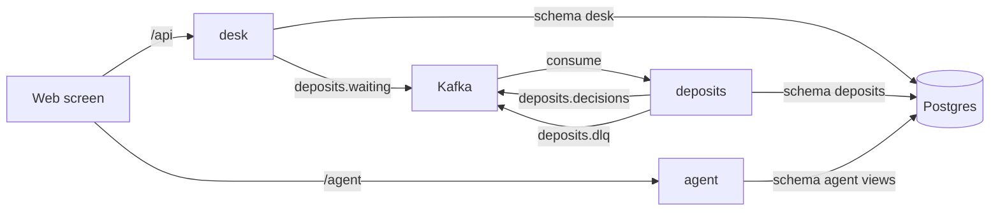

# Architecture

`desk` owns bankers, sessions, the load journal, customers, intake rows, and processing batches. It is the only service that publishes `deposits.waiting`.

`deposits` owns exchange rates, the retry policy, cases, status history, movements, and balances. It never reads `desk.customers`. The Kafka message carries the customer status and the account number.

`agent` owns no tables. `agent_reader` can select only the views in schema `agent`. Those views hide national id and phone, and they add `retryable` from `deposits.retry_policy`.

A batch links the banker session to the rows of one click. The session does not choose the rows. `POST /processing` claims every canonical intake row that is accepted, `Pending`, and not yet submitted.
